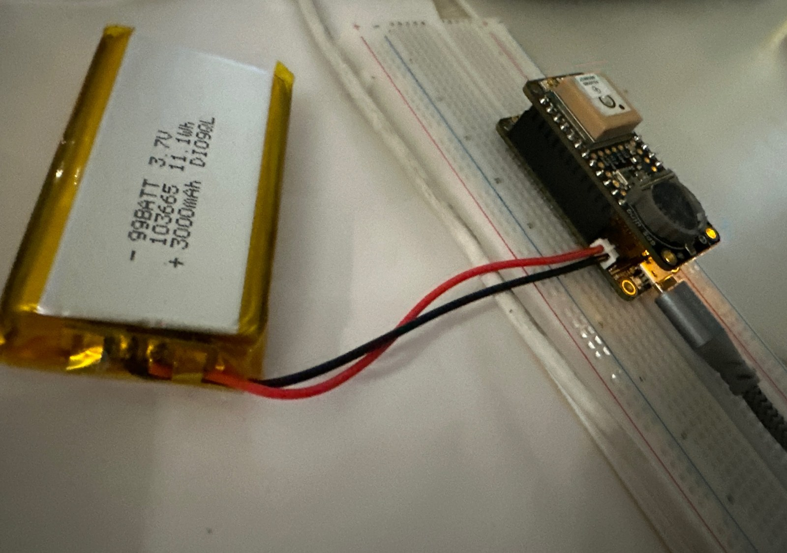
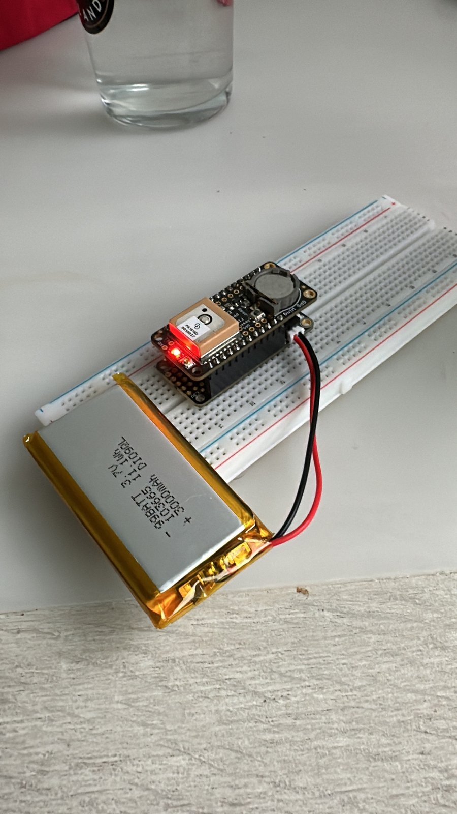

# GPS Tracker Prototype

My first hands-on hardware project (December 2024 – January 2025): an embedded GPS positioning prototype, originally conceived as a smart dog collar. A microcontroller reads satellite position data from a GPS receiver IC over a serial link, parses it, and prints the result to a computer.



## What it does

- Configures the receiver (RMC + GGA sentences only, 1 Hz updates, antenna status) over UART
- Reads and parses NMEA sentences with the Adafruit GPS library
- Once a valid fix is held, prints latitude and longitude in decimal degrees, altitude and satellite count to the Arduino Serial Monitor at most once every 10 s, plus an *Open in Google Maps* link

Wireless transmission to a phone (the "collar" part) was not built and is listed under Future work.

## Hardware

| Part | Role |
|---|---|
| Adafruit Feather M0 (ATSAMD21, ARM Cortex-M0+) | Microcontroller running the sketch |
| Adafruit Ultimate GPS FeatherWing | GPS receiver IC (MediaTek) plus antenna, stacked on the Feather |
| 3.7 V, 3000 mAh LiPo cell | Portable power (USB also works and is used for programming) |
| Breadboard | Mechanical mount |



## How it works

1. The GPS receiver listens to satellite signals and computes position, time and speed.
2. It streams the results as text lines called NMEA sentences (for example `$GPGGA`, `$GPRMC`) over UART.
3. The microcontroller reads one character at a time with `GPS.read()`. When `GPS.newNMEAreceived()` is true, `GPS.parse(GPS.lastNMEA())` validates the checksum and fills in the library's fields.
4. When `GPS.fix` is true, the sketch converts the receiver's `DDMM.mmmm` latitude and longitude to decimal degrees and prints them to the Serial Monitor.

## Result

First outdoor test, at École Polytechnique, Palaiseau (France). This is the Serial Monitor output from my first version of the sketch, which printed the library's raw values:

```
GPS Fix Data:
  Latitude: 4842.7437° N
  Longitude: 213.0130° E
  Altitude: 171.30 meters
  Satellites: 3
```

The library reports coordinates in the receiver's native `DDMM.mmmm` format, so the degree symbol in that early printout was misleading. Converting:

- Latitude `4842.7437` N = 48° 42.7437′ = **48.7124° N**
- Longitude `213.0130` E = 2° 13.0130′ = **2.2169° E**

That is the Palaiseau area, as expected. I then added this conversion to the sketch (`gps_tracker/gps_tracker.ino`), so the current version prints decimal degrees directly and a Google Maps link.

## Build and run

1. Stack the GPS FeatherWing on the Feather and connect USB (or the LiPo).
2. In the Arduino IDE, select **Adafruit Feather M0** and install the **Adafruit GPS Library** from the Library Manager.
3. Open `gps_tracker/gps_tracker.ino`, upload, and open the Serial Monitor.
4. Go outside with a clear view of the sky. A first fix can take a few minutes.

## What I learned

- Reading IC and module datasheets and matching logic levels (3.3 V)
- UART serial communication and the NMEA text protocol, including checksum validation
- Powering an embedded device from USB or a LiPo cell
- Debugging hardware outdoors, where results depend on satellite visibility

## Future work

- Send position to a phone over a wireless link (for example BLE or LoRa)
- Add a satellite-count and HDOP quality check before trusting a fix (the first fix used only 3 satellites)
- Log tracks to the module's onboard flash or to an SD card
- Fit the electronics into a small enclosure on an actual collar

## Credits and license

Uses the [Adafruit GPS Library](https://github.com/adafruit/Adafruit_GPS) (BSD license) by Limor Fried / Ladyada for Adafruit Industries. The library is installed through the Arduino Library Manager and is not included in this repository. My own sketch is released under the MIT License.
